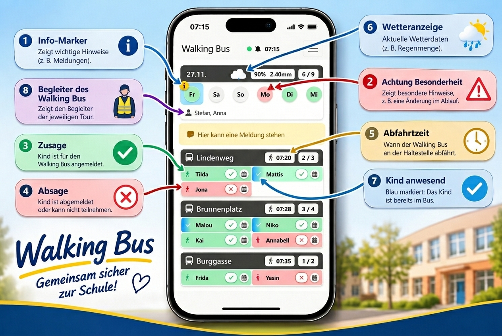

# Walking Bus Organizer

Der **Walking Bus Organizer** ist eine Webanwendung von Eltern für Eltern zur Organisation eines oder mehrerer Walking-Bus-Linien. Er koordiniert Begleitpersonen, Abfahrtszeiten, Zusagen und Absagen sowie die Zuordnung der Kinder zu den einzelnen Haltestellen.

Die Anwendung ist für den Betrieb mit Docker und eine Nutzung hinter einem Reverse Proxy vorgesehen. Sie ist **vibe-coded** entwickelt: die Umsetzung entstand in enger Zusammenarbeit mit KI-Unterstützung.

